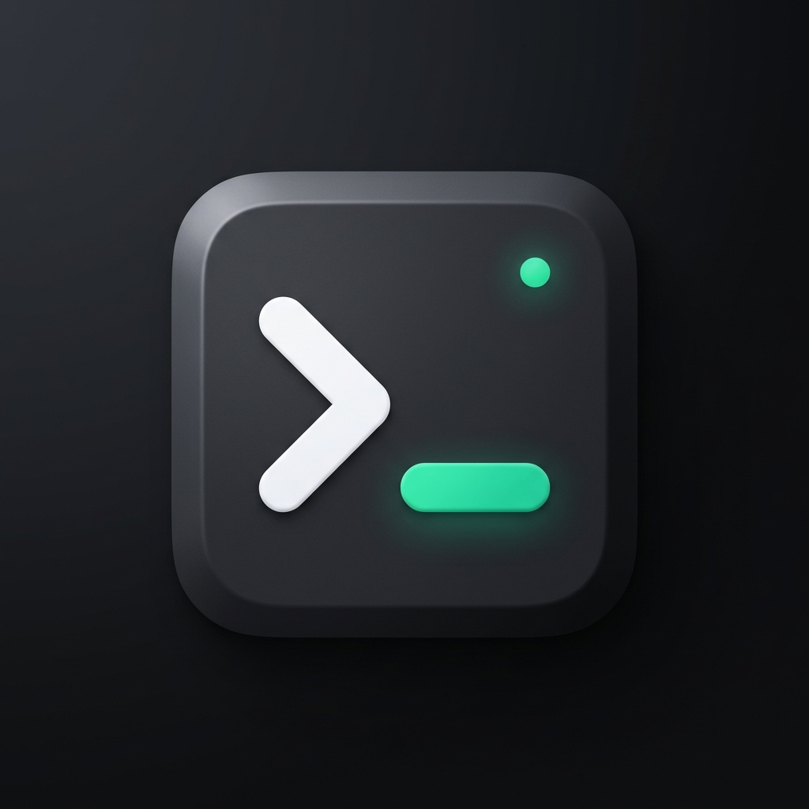

<p align="center">
  
</p>

<h1 align="center">herdr-nsgo</h1>

<p align="center">
  <strong>纯 Go + NSGo 原生跨平台 <a href="https://github.com/herdr-dev/herdr">herdr-core</a> 移动端与桌面端客户端</strong>
</p>

<p align="center">
  <a href="https://github.com/FaintGhost/herdr-nsgo/actions/workflows/release.yml"></a>
  <a href="https://github.com/FaintGhost/herdr-nsgo/releases/latest"></a>
  
  
</p>

---

**herdr-nsgo** 是面向 AI Coding Agent 与远程开发机打造的轻量原生客户端。围绕 [`herdr-core`](https://github.com/herdr-dev/herdr) 协议，以 **Quiet Studio** 设计语言与 **Chat / VT 双模视图**为核心，让你在手机或平板上就能丝滑查看多台开发机上的 **Claude Code、Codex、Gemini (Antigravity)、Pi / OMP** 会话、审批权限、实时切换模型与思考强度，并在需要时一键无缝切入真实 VT100 终端。

## 核心特性

### 1. Chat + VT 双模会话体验
- **结构化对话流（Chat View）**：自动解析 Claude Code、Codex、Antigravity (Gemini)、Pi / OMP 的本地 JSONL 对话记录，支持 Markdown 渲染、Chroma 全语种语法高亮、可折叠思考过程、结构化工具卡片（含 Git Diff 视图）、上下文窗口占用率指示，以及用户/助手消息的长按选词复制与一键复制。
- **实时模型 & 思考强度切换**：所有主流 Agent Harness 统一展示当前模型与思考强度芯片，零等待弹出选择器并直接通过远端指令同步切换，支持 `/slash` 远端命令与 Skill 自动补全。
- **忙碌队列与随时插队**：在设置中自选 Agent 忙碌时的默认发送策略（**等待** / **插队**）；等待中的消息支持一键点击「插队」优先执行；空闲或已完成会话直接正常发送。
- **真实 VT 终端 & 无扰观察模式**：桌面/iOS 端使用 Ghostty VT，Android 端无缝运行纯 Go `VTScreen` + `core.Canvas`（完整支持 ANSI 16/256/Truecolor、OSC 7501 进度条、双指缩放、滚回与键帽栏）。默认 `observe: true` 查看不改动桌面端 PTY 列宽。
- **极速加载与热缓存**：支持冷启动 0ms 首页快照恢复、6 会话内存 LRU 热切换、父/子会话后台预取，以及 Claude `/clear` 后的活跃会话自愈追踪。

### 2. 多实例并发池 & 语义待办中心
- **并发连接池 (`CorePool`)**：同时直连多台独立 `herdr-core` 实例，采用 9 字节小端 `framed` 二进制多路复用与 `events.subscribe` 实时推送；按 `CoreID` / `MachineID` 跨核去重并优先直连，断线自动回退联邦中继。
- **语义待办 & 汇报完成**：聚合跨实例的「等你审批」「出错」「任务汇报完成」三类高优事件；支持对 Claude / Codex / Antigravity / Pi / OMP 在聊天模式和待办列表一键「允许 / 拒绝」（执行前二次校验状态防误触），并配合 Android `POST_NOTIFICATIONS` 本地系统通知提醒。
- **多模态输入**：支持一键语音听写、拍照/相册/剪贴板图片与文档分块上传（`terminal.put_begin/chunk/finish`）、项目文件与 Git Diff 浏览器。

### 3. Quiet Studio 主题工坊 & 多字体系统
- **4 套主题 × 亮暗模式**：`Quiet Studio`、`Warm Paper`、`Nordic Slate`、`Emerald Lab`（全部 8 组色板通过 WCAG AA `>= 4.5:1` 自动化对比度校验），外加 4 套终端配色方案（`Graphite`、`Tokyo Night`、`Catppuccin`、`Gruvbox`）。
- **多字体与字号调节**：内置 `JetBrains Mono Nerd`、`Fira Code`、`IBM Plex Mono` 等宽字体与正文无衬线/衬线切换，即时预览并实时生效于对话、代码与终端。
- **自适应跨端布局**：`< 680px` 手机端采用悬浮毛玻璃三 Tab 导航，`>= 680px` 平板/桌面端自动展开三栏工作台；统一顶层悬浮毛玻璃自动消失提示胶囊，零布局抖动。

### 4. 安全基线 & 应用内自动更新
- **1 分钟免密上手**：应用内自动生成 `ed25519` 密钥对并提供一键复制 `authorized_keys` 命令；凭据存于系统安全存储（Android Keystore / iOS Keychain）；强制 TOFU 主机指纹校验，支持 `herdr://pair?v=1&...` 扫码配对。
- **签名 OTA 自动更新**：接入 NSGo 原生 Ed25519 签名更新机制 + GitHub Actions 自动构建发布。Android 端打开 **设置 → 应用更新与关于 → 检查更新** 即可自动校验签名、下载并原地覆盖安装最新版本，完整保留所有主机与密钥配置。

## 安装与更新

### Android（推荐直接下载 Release）
1. 前往 [Releases 页面](https://github.com/FaintGhost/herdr-nsgo/releases/latest) 下载最新的 `herdr-nsgo-*-android-arm64.apk` 安装。
2. 后续所有更新均可在 App 内 **设置 → 检查更新** 一键完成原地升级，无需重新连线或卸载。

### 从源码开发与构建

```sh
# 1. 运行全量测试套件（含 -race 竞态检测、WCAG 对比度校验、协议与 headless UI 测试）
go test -race ./...

# 2. 本地桌面端热重载预览
go tool nsgo dev

# 3. 构建 Android ARM64 APK（纯 Go 打包，无需安装 Android SDK / Gradle）
go tool nsgo build -target android_arm64 -output dist

# 4. 通过 ADB 安装到 Android 设备
adb install -r dist/releases/herdr-nsgo-1.0.0-android-arm64.apk

# 5. 构建桌面端 / iOS
go tool nsgo build -target macos_arm64 -output dist
go tool nsgo build -target ios_arm64 -output dist
```

## 自动构建与发布（CI / CD）

仓库内置 [`.github/workflows/release.yml`](.github/workflows/release.yml)：
- 推送 `main` 分支或 `v*` 标签后自动执行 `go test -race ./...`。
- 测试通过后自动编译 Android ARM64 APK、生成 Ed25519 签名的 `appcast-android_arm64.xml` 与 SHA-256 校验文件，并发布至 GitHub Releases。
- 需在仓库 Secrets 配置：
  - `NSGO_UPDATES_KEY`：由 `go tool nsgo keygen` 生成的更新签名私钥（对应 `nsgo.yaml` 中的 `updates.key` 公钥）。
  - `ANDROID_DEBUG_PEM_B64`：Android APK 签名密钥（Base64），确保云端产物与手机已装包签名一致，实现无感原地升级。

## 项目结构

| 模块 | 文件 | 职责 |
|---|---|---|
| **协议与连接** | [`proto.go`](proto.go) / [`framed.go`](framed.go) / [`client.go`](client.go) / [`transport.go`](transport.go) | `herdr-core` RPC 类型、9 字节 LE `framed` 多路复用、分块文件上传与 SSH 拨号 |
| **安全与配对** | [`secrets.go`](secrets.go) / [`pairing.go`](pairing.go) | 系统密钥库存储、TOFU 主机指纹固定、`ed25519` 密钥生成与二维码配对 |
| **多实例与状态** | [`pool.go`](pool.go) / [`app.go`](app.go) / [`snapshot_store.go`](snapshot_store.go) / [`approvals.go`](approvals.go) | `CorePool` 并发管理、跨核去重、通知权限与提醒、安全审批白名单与本地快照 |
| **对话与智能体** | [`chat_parser.go`](chat_parser.go) / [`chat_session.go`](chat_session.go) / [`chat_delivery.go`](chat_delivery.go) / [`agent_catalog.go`](agent_catalog.go) / [`syntax_highlight.go`](syntax_highlight.go) | Claude / Codex / Gemini / Pi JSONL 解析、热预取与尾部追踪、队列/插队、模型与思考强度同步、语法高亮 |
| **真实 VT 终端** | [`vt_screen.go`](vt_screen.go) / [`vt_view.go`](vt_view.go) / [`multiplexer.go`](multiplexer.go) | 纯 Go VT100/Truecolor + OSC 7501 仿真器、Ghostty/Canvas 双后端与终端多路复用器 |
| **设计系统与界面** | [`theme.go`](theme.go) / [`fonts.go`](fonts.go) / [`icons.go`](icons.go) / [`components.go`](components.go) / `screen_*.go` / [`main.go`](main.go) | Quiet Studio 多主题与多字体系统、品牌图标、悬浮提示胶囊、全量业务屏幕与自适应壳层 |
| **自动化测试** | `*_test.go` | 竞态安全测试、WCAG 对比度与无裸色检查、解析器/连接池/OTA 更新与 `nsgotest` UI 测试 |

更多界面规范见 [`DESIGN.md`](DESIGN.md)。
